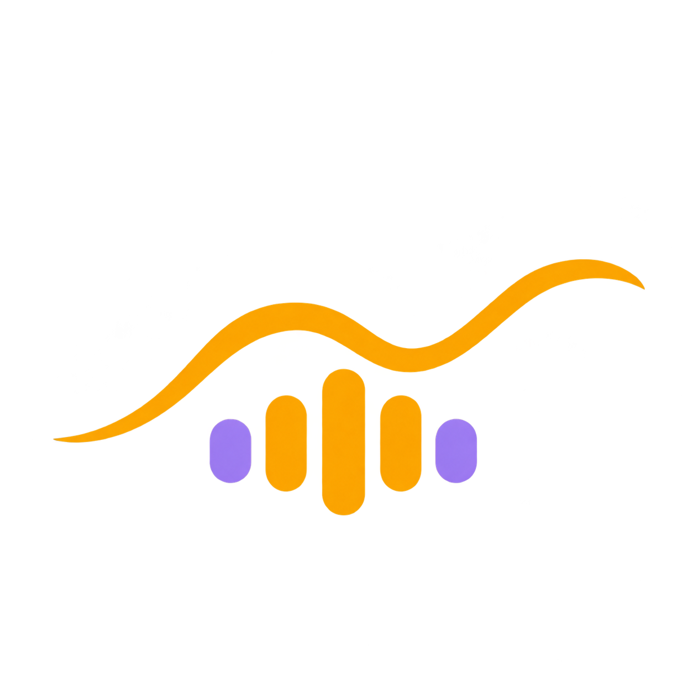

<div align="center">



# frasi.

### Every note. Every rhythm. Every phrase.

An open-source jazz transcription, harmonic analysis, and twelve-key practice studio.

</div>

> Frasi is under active construction. The checked implementation status and verified
> limitations live in [`docs/IMPLEMENTATION_STATUS.md`](docs/IMPLEMENTATION_STATUS.md).

## Repository map

```text
apps/web             Next.js transcription and practice studio
services/api         FastAPI application and persistence
services/worker      Background transcription worker
packages/music-core  Shared symbolic music and transposition engine
packages/shared-types API contracts shared with the browser
ml/frasi_ml          Signal-processing transcription pipeline
infrastructure       Containers and deployment configuration
docs                 Architecture, decisions, and verification evidence
```

## Local development

Requirements: Node.js 22+, pnpm 10+, Docker Desktop, and Docker Compose.

```bash
cp .env.example .env
pnpm install
docker compose up --build
```

The web studio is served at `http://localhost:3000`; API docs are at
`http://localhost:8000/docs`.

## License

[MIT](LICENSE)
