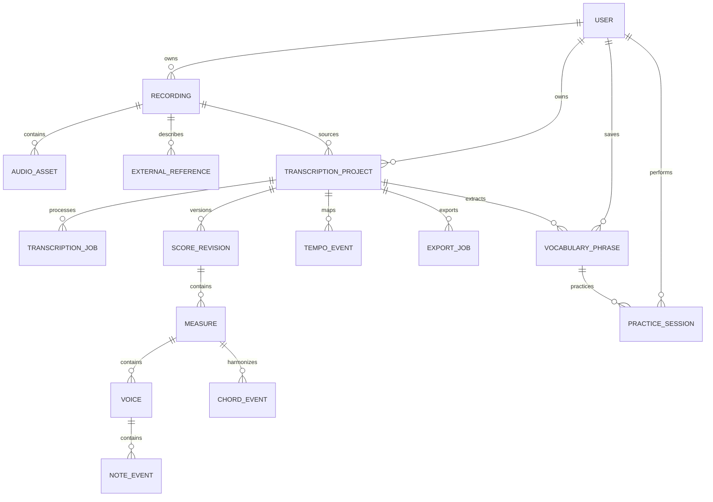

# Data model

## Timing invariants

Every note event carries both representations:

- `performance_onset_seconds`, `performance_offset_seconds`, detected MIDI pitch, confidence;
- measure index, rational beat position, rational duration, spelling, tuplet, and tie metadata.

Editing symbolic values never overwrites performance timing. Locked chord events survive later AI
reprocessing. A score revision is immutable after publication; edits create a child revision.
