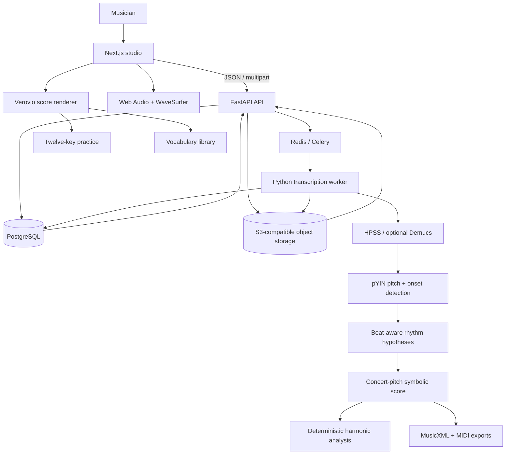
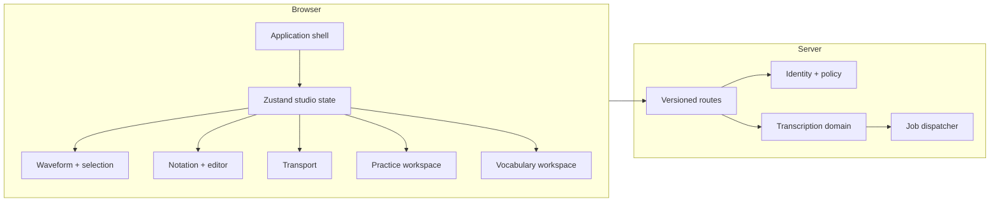
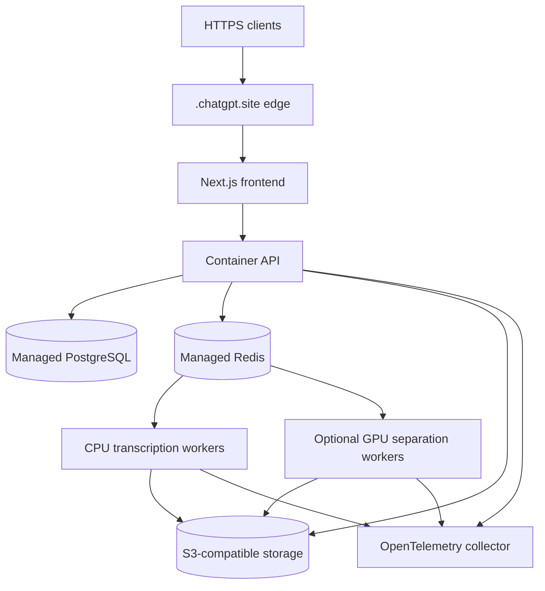

# System architecture

Frasi keeps the browser, API, background worker, and signal-processing library as distinct
modules while retaining one repository and one versioned domain model.

## Design boundaries

- Concert pitch is canonical. Instrument notation and practice transposition are derived,
  independent views.
- Performance timing is immutable evidence. Symbolic timing is an editable interpretation.
- Uploaded audio lives in object storage, never in relational rows.
- The API owns authorization. Storage identifiers are opaque and are never accepted as direct
  filesystem paths.
- Processing stages emit confidence and versioned intermediate artifacts so a correction can be
  traced to its source.

## Component architecture

## Deployment architecture

The Sites edge can host the web surface. The Python API, database, queue, object storage, and
workers require separately provisioned production infrastructure; a frontend-only deployment is
not classified as a complete Frasi production deployment.
